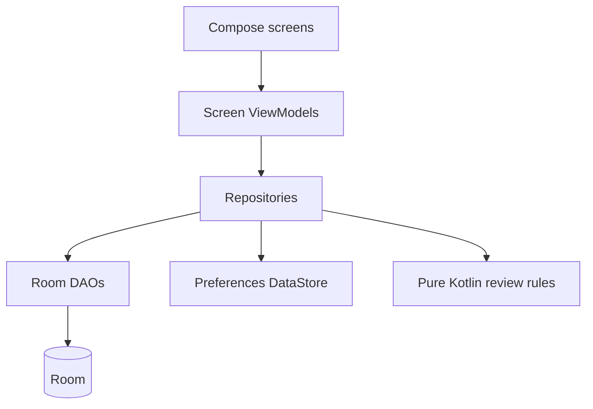

# Technical Stack, Architecture & Learning References

Version 3.0 — technical baseline for the solo Android MVP.

## 1. Learning model

A card presents a prompt before the learner reveals the answer and rates their own recall.
Remembered advances through the fixed ladder of 1, 3, 7, 14, 30 and 60 calendar days, capped
at 60. Forgot resets to stage 0 and schedules tomorrow. New cards start at stage 0 and are
immediately eligible. The ladder is a simple spaced-repetition heuristic. The
[business rules](4-Business-Rules.md#br-12--date-scheduling-fr-09) specify dates and transitions.

## 2. Native Android stack

| Area | Choice |
| --- | --- |
| Language and build | Kotlin, existing Gradle wrapper, Kotlin DSL and version catalog |
| UI and navigation | Jetpack Compose, Material 3, one activity and one Navigation Compose host |
| State and events | Screen ViewModels, immutable StateFlow UI state, lifecycle-aware collection and explicit events |
| Local data | Room with foreign keys, indexed queries and transactions |
| Selection | Preferences DataStore stores the active profile ID. Room verifies that it exists. |
| Async | Kotlin Coroutines and Flow |
| Tests | JUnit for Kotlin rules, Room integration tests and representative Compose UI tests |
| Android floor | API 24 with core library desugaring for calendar arithmetic |

The existing project pins tool versions. The app performs its work on-device and needs no
authentication, backend or network library.

## 3. Architecture

- One application-level AppContainer constructs repositories with direct DAO injection.
  A standard ViewModel factory supplies dependencies. Use Flow for observations and suspend
  functions for writes.
- Compose collects state with lifecycle awareness and sends explicit events to ViewModels.
  Keep editable drafts and the current study session in screen-owned state across rotation.
- Repositories and DAOs use the profile ID captured at operation start. Study queries,
  grade commits and summary reads also use the originating set. Clear the old UI and cancel
  its observations on profile switch.
- A grade appends one ReviewLog and updates the card schedule in one Room transaction.
  The composite key (sessionId, cardId) prevents a repeated submission from committing twice.

## 4. Room v1 schema target

| Table | Fields and relationships |
| --- | --- |
| Profile | ID, display name, creation timestamp |
| StudySet | ID, owner profile ID, name and optional description. The owner foreign key cascades on deletion. |
| Flashcard | ID, parent set ID, front and back text, creation timestamp, stage and nullable dueDay. The set foreign key cascades on deletion. |
| ReviewLog | Composite primary key (sessionId, cardId), grade and review timestamp. The card foreign key cascades on deletion. |

Store due dates as local calendar epoch days and review timestamps as instants. Index owned
set lookups and card queries by set. Cards and logs inherit ownership through their parent set.

The authorized pre-release transition replaces the old development schema and its v1 export
with the four-table v1 baseline. FlashcardApp has no released installations or real user data.
A clean development reset requires no migration from the former `study_groups` table.
On startup, resolve any saved profile ID against the current database before showing a Set List.
Future schema changes affecting released user data require a data-preserving migration.

## 5. Verification

- **JVM:** schedule transitions, eligibility, local calendar boundaries and summary calculations.
- **Room:** two profiles and stale IDs, cascades, file reopen, atomic rollback, retry and duplicate grades.
- **Compose:** representative profile navigation, invalid input, answer reveal, grading and summary return.
- **Device:** debug build and airplane-mode walkthrough with restart, rotation and core controls in both orientations at 100% and 130% font scale.

## 6. Course references

Use [Android Basics with Compose](https://developer.android.com/courses/android-basics-compose/course)
as the primary learning reference. Inventory demonstrates Room, direct DAO repository injection
and the ViewModel factory. Mars Photos demonstrates manual application container wiring. Dessert
Release demonstrates Preferences DataStore. Cupcake demonstrates a single NavHost with navigation
callbacks. Use the local sample projects as read-only references.
