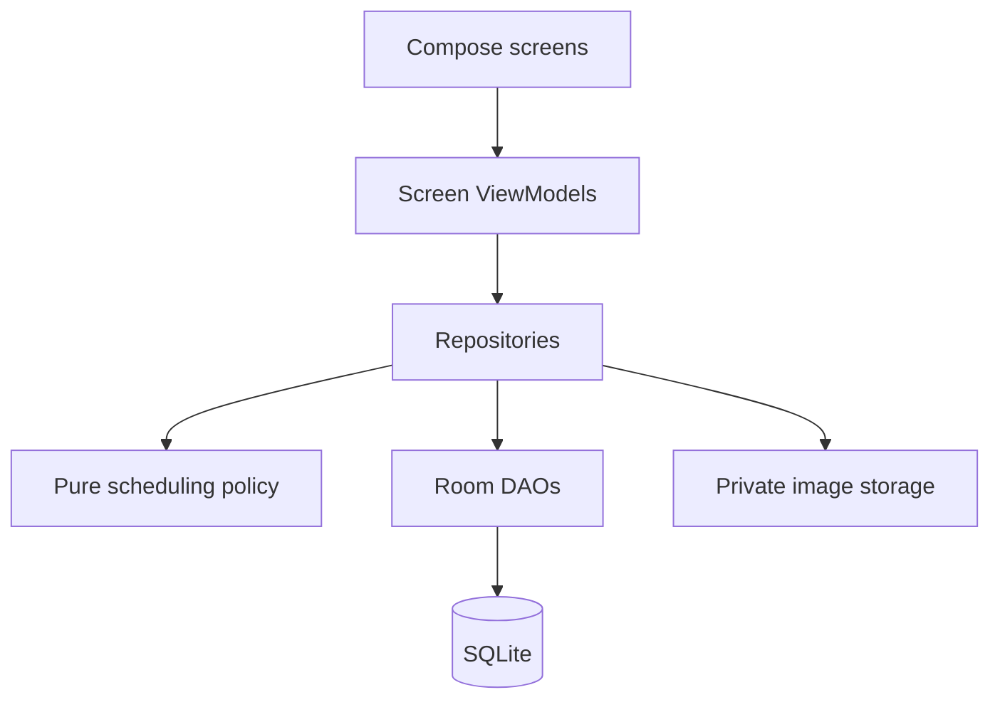

# Technical Stack, Architecture & Theoretical Background

Version 1.1 — technical background and design inputs for the Android MVP.

## 1. Learning theory

- **Flashcard:** a two-sided prompt/answer learning unit.
- **Active recall:** the learner attempts to retrieve an answer before revealing it; the app does not objectively judge semantic correctness.
- **Forgetting curve:** a conceptual explanation of declining retention over time, not a universal numerical formula for every learner.
- **Spaced repetition:** revisiting material at intervals, increasing the interval after successful retrieval and shortening it after forgetting.

### Approved v1.0 scheduler — binary fixed interval ladder

The original two-button Grade Mode is retained. To fit a three-week course project, use a deterministic interval-ladder heuristic inspired by spaced repetition, not a claim of implementing SM-2 or FSRS:

| Stage after Remembered | Interval (calendar days) |
| --- | ---: |
| 1 | 1 |
| 2 | 3 |
| 3 | 7 |
| 4 | 14 |
| 5 | 30 |
| 6 (cap) | 60 |

Remembered increases the stage up to 6; Forgot resets stage to 0 and schedules tomorrow. New cards start at stage 0 and are immediately eligible. For review-date and grade transaction behavior see [business rules](4-Business-Rules.md). The [specification clarifications of 2026-11-21](../specs/001-offline-flashcard-study/spec.md#session-2026-11-21) approve these intervals and the next-day Forgot reset.

## 2. Native Android technology

| Area | Selected or proposed technology |
| --- | --- |
| Language | Kotlin |
| Build | Existing Android Studio template, Gradle wrapper, Kotlin DSL and existing version catalog where available |
| UI | Jetpack Compose, Material 3, Compose Animation |
| Adaptive UI | Window size classes; Material 3 Adaptive components only if useful |
| Navigation | Navigation Compose |
| State | Lifecycle ViewModel, immutable UI state, StateFlow, lifecycle-aware collection |
| Local data | SQLite via Jetpack Room (entities, foreign keys, indexes, DAOs and transactions) |
| Async | Kotlin Coroutines and Flow |
| Settings | Preferences DataStore for active-profile ID or simple equivalent; Room is the source of truth for profile existence |
| Images (P2) | Android Photo Picker/appropriate fallback + app-private files; no upload |
| Tests | JUnit, kotlinx-coroutines-test, Room/repository integration tests, Compose UI and navigation tests |
| Min SDK | API 24 with core library desugaring for calendar arithmetic. The starter launch is recorded in the [Phase 1 evidence](../specs/001-offline-flashcard-study/quickstart.md#phase-1-verification). |

Pin compatible versions in the actual project, not this document. Do not add Retrofit, Kotlinx Serialization for networking, Hilt, Firebase, a remote backend or network permissions solely for hypothetical future use. Reassess if a future approved feature needs them.

## 3. Architecture

Single app module, single-activity, layered UI and data architecture; a small pure scheduler/domain package is useful for testability. MVVM and unidirectional data flow: UI sends events, ViewModel coordinates work, repository owns data operations, observable state returns to UI.

- Manual dependency injection via Application-level AppContainer and ViewModel factory (compatible with course content). Follow the Inventory and Mars Photos samples. Inject DAOs directly into repositories. Use Flow for observations and suspend functions for one-time operations.
- State hoisting for reusable presentational composables. Use lifecycle-aware state collection and preserve necessary UI state during rotation.
- The repository and DAO check ownership using the profileId captured when the operation starts. On a switch the UI clears the previous stack and cancels its observations.
- Use one Room transaction for the grade and schedule, and the (sessionId, cardId) primary key to prevent duplicate updates.
- No use of destructive migration fallback for releases containing real user data. Establish migrations when schema changes.

## 4. Conceptual data model

| Entity | Main attributes / relationships |
| --- | --- |
| Profile | ID, display name, created timestamp |
| Group | ID, owner profile, name, optional description |
| FlashcardSet | ID, owner profile, optional group, name, optional description |
| Flashcard | ID, parent set, front/back text, optional image references, created timestamp, stage, nullable review due date |
| ReviewLog | Composite primary key (session ID, card ID), grade, actual review timestamp |

Every child relationship must resolve to the same owner. Formal schema and ownership enforcement belong in the generated data model. Use a date-only representation for due dates and an instant for review logs; specify the time-zone policy in the plan.

## 5. Verification strategy

- Pure unit tests for every stage transition, cap, forgetting, due/overdue rules and date boundaries using explicit local dates.
- Room tests for cross-profile access, foreign keys, group deletion, set/profile deletion, and atomic/idempotent grading.
- Compose tests for front/back flip, rating gating, summary, validation and profile switching.
- Manual offline/restart, rotation and resized window smoke tests.
- Typical commands from project root: `./gradlew assembleDebug`, `./gradlew testDebugUnitTest`, `./gradlew connectedDebugAndroidTest` (requires an emulator/device; use gradlew.bat on Windows).

## 6. References

- [Android Basics with Compose](https://developer.android.com/courses/android-basics-compose/course)
- [Android architecture recommendations](https://developer.android.com/topic/architecture/recommendations)
- [Android data layer](https://developer.android.com/topic/architecture/data-layer)
- [Manual dependency injection](https://developer.android.com/training/dependency-injection/manual)
- [Android offline-first guidance](https://developer.android.com/topic/architecture/data-layer/offline-first)

Future remote data sources may be introduced behind repositories, but synchronization, conflicts, security and migrations would require a new design and specification; they are not guaranteed to be refactor-free.
