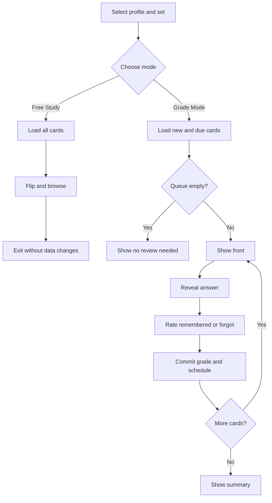

# Business Rules & User Workflows

Version 1.1 — proposed decisions to review before running Spec Kit. Requirement IDs refer to the companion Functional Requirements document.

## 1. Glossary

- Profile: local learner workspace. At most one profile is active. There is no active profile while the selector awaits explicit selection.
- Group: optional organizational category for sets; not a nested folder.
- Flashcard set (deck): collection of cards, belonging to one profile and optionally one group.
- Card: mandatory front and back text with optional local images.
- Free Study / Non-Grade Mode: browse any cards in a set without affecting progress.
- Graded Review / Grade Mode: self-rate eligible cards and update review schedules.
- New: no committed rating yet. Due: review date is today or earlier. Overdue: date is earlier than today.

## 2. Profile and library

| ID | Rule | Related |
| --- | --- | --- |
| BR-01 | Require a trimmed, nonblank display name. Restore a valid saved profile. After active-profile deletion or an invalid selection, show creation if no profiles remain. Otherwise show the selector, even for one survivor. Open Home only after explicit selection in this recovery flow. | FR-01 |
| BR-02 | A profile's data is logically isolated; all data access checks ownership. Switching profiles clears previous navigation/session state. No password/security boundary is implied. | FR-02 |
| BR-03 | Group/set names are trimmed and non-blank, descriptions are optional. Proposed limits: names 1–80 characters, descriptions up to 500. Duplicate names are allowed; IDs are authoritative. | FR-03, FR-04 |
| BR-04 | Groups are flat. Sets are assigned to at most one group; removing a group moves its sets to Ungrouped. | FR-03, FR-04 |
| BR-05 | A set may be empty. Cards have one parent set; front and back text each contain 1–2,000 characters after trimming. Duplicate cards are allowed. | FR-05 |
| BR-06 | Profile deletion permanently removes all owned groups, sets, cards and review logs. Set deletion removes its cards/logs. Card deletion removes that card/logs. Require explicit confirmation. | FR-01, FR-04, FR-05 |
| BR-07 | Text/image edits preserve existing scheduling and history. Moving a set within its profile preserves every card and schedule. Cross-profile moves are not supported. | FR-04, FR-05 |
| BR-08 | Optional P2 images are selected from device media, copied privately and linked to a side; deletion/replacement removes unneeded files without invalidating retained references. Reject unreadable or oversized inputs with a message. | FR-06 |

## 3. Study session lifecycle

### BR-09 — Free Study (FR-07)

- Queue: all cards in the selected set, ordered by creation then ID.
- Present front by default; flip repeatedly; Previous/Next available when valid.
- Entire set may be reviewed even when cards are not due. The mode is read-only with respect to learning metrics and schedule.
- Empty set: explain no cards exist and offer Add card.

### BR-10 — Graded Review queue (FR-08, FR-10)

- Start from Home (all profile's due/new cards) or an individual set.
- Capture a queue snapshot on start: overdue and due reviewed cards first (ascending review date then ID), new cards afterward (creation then ID).
- A new card is eligible immediately; reviewed card eligible iff due date is not later than today's date.
- Each eligible card appears at most once in the session; forgotten cards return tomorrow, not again in the current session.
- New cards created mid-session enter a future session, not this snapshot. If a queued card no longer exists or no longer belongs to the active profile, skip it. Keep its place in the frozen ordering: the next card shows its original one-based position out of the original queue size. Skipping card 2 of 3 leaves card 3 at “3 of 3” and contributes zero committed ratings.
- Empty queue: state that nothing is due; optionally provide a route to Free Study or library, not manual grade before a card is due.

### BR-11 — Recall response and atomic update (FR-08, FR-09)

- Each card starts on front. Flip is available at any point; a learner must reveal the back at least once before rating.
- Remembered and Forgot are self-reported. No automatic semantic checking.
- On rating, disable rating controls during save. Validate eligibility, current ownership and session-card uniqueness. Record grade and new scheduling state atomically.
- Advance once the committed outcome is known. A rolled-back grade leaves all learning data unchanged and the current card available for retry. If the grade committed but its acknowledgement was lost, retrying the same session/card returns the original committed result without adding a rating or updating the schedule again.

### BR-12 — Date scheduling (FR-09)

This deterministic proposed policy uses date-only values and an injected clock. Let today be the device local calendar date captured at rating commit. Store dates, not millisecond multiples of 24 hours; compare with the current device local date on subsequent launches. Log actual review timestamps separately. Changing device date/time zone may affect what is due; do not retroactively rewrite stored review dates.

| Event | Transition | Next review |
| --- | --- | --- |
| Card created | stage = 0, no review date | eligible immediately |
| Remembered at stage 0 | stage 1 | today + 1 day |
| Remembered at stage 1 | stage 2 | today + 3 days |
| Remembered at stage 2 | stage 3 | today + 7 days |
| Remembered at stage 3 | stage 4 | today + 14 days |
| Remembered at stage 4 | stage 5 | today + 30 days |
| Remembered at stage 5 or 6 | stage 6 | today + 60 days |
| Forgot at any stage | stage 0 | today + 1 day |

An overdue review is rescheduled from the actual review day, not the previous due date. Stage 0 after forgetting is distinguished from a new card by its non-null due date and committed history. Successful retrieval and forgetting on a new card may both schedule tomorrow, but produce different stages.

Examples:

- Create 21 Nov: new. Remembered on 21 Nov -> stage 1, due 22 Nov.
- Remembered on 22 Nov -> stage 2, due 25 Nov.
- Review late on 27 Nov, Remembered -> stage 3, due 4 Dec.
- Forgot on 4 Dec -> stage 0, due 5 Dec.

### BR-13 — Interrupted session and summary (FR-11, FR-12)

- Back/exit asks whether to end the session if unreviewed cards remain. Confirmed ratings remain committed.
- During rotation, preserve queue/index/flip state when possible via ViewModel. After process death, creating a fresh queue is acceptable; do not revert or repeat committed grades.
- Summary: reviewed = remembered + forgot; recall rate = remembered / reviewed × 100%, rounded to whole percent. If reviewed = 0, show no percentage.
- Exit returns to the starting scope; outstanding ungraded cards remain due/new.

### BR-14 — Progress (FR-13)

If P2 is implemented, coverage = current cards with at least one committed grade / current total cards × 100%. It measures exposure, not retention or mastery. A deleted card no longer contributes. Zero-card profiles show “No cards yet”.

### BR-15 — Optional timer (FR-14)

A timer, if approved after MVP, is a study aid only. Expiry does not change scheduling or count as a grade without user action.

## 4. Main workflows

1. Onboarding: launch -> create profile -> Home -> create set.
2. Organize: Home -> Library -> create group or set -> add cards -> save -> return to detail.
3. Study freely: Set detail -> Free Study -> flip/navigate -> exit.
4. Review: Home or Set detail -> Grade Mode -> reveal -> grade -> next -> summary.
5. Switch: profile selector -> choose another profile -> new Home with empty/owned data.

## 5. Decisions to approve and refine during clarification

- Adopt the proposed interval ladder versus a named SM-2/FSRS implementation.
- Confirm grading is only for due/new cards; free learning covers any cards.
- Confirm group deletion preserves sets, but set/profile/card deletion removes their owned history.
- Confirm limits, image support priority, and session restart policy.
- Confirm MVP scope against the three-week deadline. If an item must be cut, reduce P2/P3 before weakening isolation or persistence.
