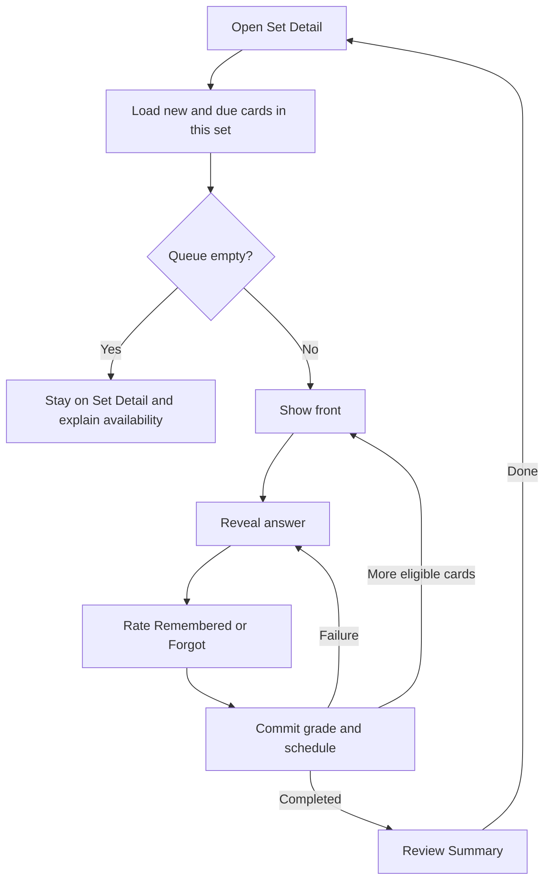

# Business Rules & User Workflows

Version 3.0 — business rules for the solo MVP. Requirement IDs refer to the
[functional requirements](2-Functional%20Requirements.md). Retired rule IDs remain reserved.

## 1. Glossary

- **Profile** is a local learner workspace. At most one profile is active.
- **Study set** is a collection of two-sided text cards owned by one profile.
- **New, due and overdue** describe a card with no saved date, a review date on or before
  today, and a review date before today, respectively.
- **Graded Study** is a set-scoped session in which the learner rates their own recall.

## 2. Profile and library

| ID | Rule | Related |
| --- | --- | --- |
| BR-01 | Trim the profile display name and require a nonblank value. Resolve the saved profile ID against Room. A valid selection opens Set List. With zero profiles, show creation. With profiles but no valid selection, including after deleting the active profile, show the selector and require an explicit choice even for one survivor. A failed storage read offers retry. | FR-01 |
| BR-02 | Every owned operation uses the profileId selected when it starts. Verify ownership in repositories and DAOs. Switching clears the old navigation stack, drafts, session and displayed data and cancels old UI observations. An in-flight operation may finish only for its original owner. Its result cannot appear in the new profile. | FR-02 |
| BR-03 | Trim set names and require 1–80 characters. Trim the optional description and save a blank result as null. A nonblank trimmed description may contain up to 500 characters. Duplicate set names are allowed and IDs identify records. | FR-04 |
| BR-04 | Removed / Out of scope in v3.0 | FR-03 |
| BR-05 | A set may be empty. Each card belongs to one set. Each trimmed text face must contain 1–2,000 characters. Duplicate card text is allowed. | FR-05 |
| BR-06 | Require confirmation and explain the effects of deletion. Deleting a profile removes its sets, cards and review logs. Deleting a set removes its cards and their logs. Deleting a card removes that card and its logs. Unrelated records remain intact. | FR-01, FR-04, FR-05 |
| BR-07 | Set metadata and card text edits preserve existing schedules and review history. | FR-04, FR-05 |
| BR-08 | Optional card images are deferred beyond v1. | FR-06 |

## 3. Study session lifecycle

### BR-09 — Removed / Out of scope in v3.0

Former Free Study behavior (FR-07).

### BR-10 — Graded Study queue (FR-08, FR-10)

- Start from the selected profile's Set Detail and scope the session to that set. A card is
  eligible when `dueDay == null || dueDay <= today`, using the device's local calendar day.
  A null date marks a new card. Reviewed cards with an earlier date are overdue.
- Capture an ordered snapshot of eligible IDs when study begins. Put reviewed cards due today
  or earlier first, ordered by due date then ID. Put new cards after them, ordered by creation
  time then ID. Include each card at most once.
- New arrivals wait for a later session. Skip cards that become unavailable or ineligible,
  keeping their original position in the snapshot. For example, if card 2 of 3 is skipped, the
  next card still shows 3 of 3. Skips add no ratings.
- Refresh Set List and Set Detail counts on data changes and on foreground return when the local
  day changes. Recheck eligibility at study start. With an empty queue, stay on Set Detail and
  show why study is unavailable. Offer Add card if the set is empty.

### BR-11 — Recall and atomic grading (FR-08, FR-09)

- Start each card on the front. The learner can flip repeatedly. Enable Remembered and Forgot
  after the first answer reveal for that card, including if the learner flips back to the front.
- When the learner taps a rating, disable both ratings, Exit and system Back during the save.
  At commit, verify the originating profile and set. For a new submission, recheck eligibility.
- Insert one ReviewLog and update the schedule in one Room transaction. The (sessionId, cardId)
  key leaves the first committed log and schedule intact when a submission repeats or competes
  with another. Advance once only after commit. A failed transaction leaves the revealed card
  available for retry and leaves its schedule and history intact. Restore navigation after
  success or failure.

### BR-12 — Date scheduling (FR-09)

Calculate the next date from the device's local calendar date captured when the grade is saved.
Pass that date explicitly to the scheduling rule. Store the next review date as a calendar day
and record the actual review timestamp separately. A device date or time zone change can affect
eligibility. Saved dates stay as recorded.

| Event | Stage after | Next review |
| --- | --- | --- |
| Card created | 0 | No due date, eligible immediately |
| Remembered at stage 0 | 1 | Today + 1 day |
| Remembered at stage 1 | 2 | Today + 3 days |
| Remembered at stage 2 | 3 | Today + 7 days |
| Remembered at stage 3 | 4 | Today + 14 days |
| Remembered at stage 4 | 5 | Today + 30 days |
| Remembered at stage 5 or 6 | 6 | Today + 60 days |
| Forgot at any stage | 0 | Tomorrow |

Grade overdue cards from the actual review day. For example, a stage-1 card due on November 22
and rated Remembered on November 24 advances to stage 2 and is due November 27. A forgotten
stage-0 card has a due date, so it is eligible again tomorrow.

### BR-13 — Interruption and summary (FR-11, FR-12)

- While idle, Exit or Back asks for confirmation if ungraded cards remain. Cancel keeps the
  current session. Confirming exit keeps committed grades and goes to Review Summary.
- Retain the queue, position, visible face and reveal state on rotation. After process death,
  a later session may use a fresh queue. Only committed grades affect that queue.
- At completion or confirmed early exit, show reviewed, remembered and forgot counts from
  committed grades. Reviewed equals remembered plus forgot. Recall rate is remembered divided
  by reviewed, rounded to a whole percentage. Omit the rate when reviewed is zero.
- Done returns to the originating Set Detail. Outstanding ungraded cards keep their saved
  eligibility and their schedules are untouched.

### BR-14 — Aggregate coverage (FR-13)

Deferred beyond v1.

### BR-15 — Optional countdown (FR-14)

Deferred beyond v1.

## 4. Main workflows

1. Launch offline and select or restore a profile. Its Set List opens directly.
2. Create or open a set and manage its metadata and text cards through Set/Card Editor.
3. From Set Detail, start Graded Study, reveal and rate cards, and view Review Summary.
4. Select Done to return to the set. Use the profile control on Set List to switch or manage profiles.
