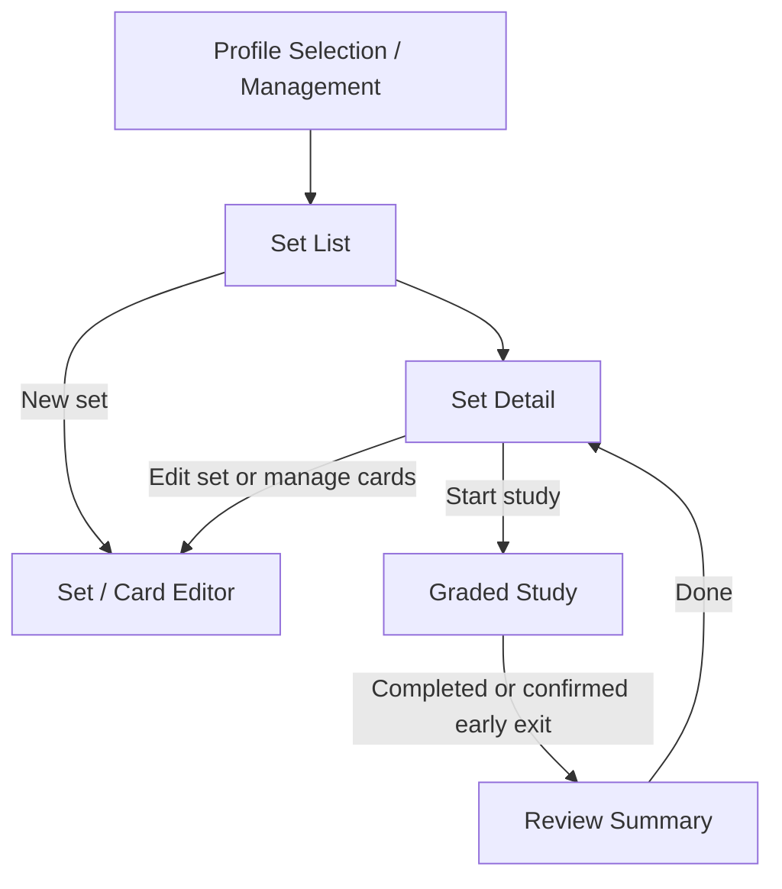

# Application Description & Screen Behavior

Version 3.0 — six screen types for one offline study flow.

## 1. Navigation

After an explicit profile selection or restoration of a valid saved profile, open Set List.
Set List offers the profile control for selection and management. Switching profiles opens
the new Set List with a fresh back stack. The shared editor returns to its parent after save
or confirmed discard. Set Detail is the entry point for Graded Study.

## 2. Screen inventory

| ID | Screen | Main content and actions | Requirements |
| --- | --- | --- | --- |
| UI-01 | Profile Selection/Management | List local profiles with an active marker. Create, rename, select and confirm deletion. Show creation when no profiles exist and retry when selection restoration fails. | FR-01, FR-02, FR-12 |
| UI-03 | Set List | Show the active profile, owned sets in stable order, total and eligible card counts for each, a profile control and Create set. Tap a set to open its detail. | FR-02, FR-04, FR-10 |
| UI-06 | Set Detail | Show set name, optional description, total and eligible counts, and a list of editable card rows. Show the next date for each reviewed card. Offer Add card, Start study, Edit set and confirmed deletion. | FR-04, FR-05, FR-08–FR-10 |
| UI-05 | Set/Card Editor | Share one screen for set name and optional description or card front and back text. Provide labeled inputs, inline validation, Save and Cancel. Confirm deletion of an existing card. | FR-04, FR-05, FR-12 |
| UI-09 | Graded Study | Show one card, Front/Back and Flip, original queue position and committed-review count. Enable Remembered/Forgot after reveal. Show saving feedback, retry and an exit confirmation when applicable. | FR-08, FR-09, FR-12 |
| UI-10 | Review Summary | Show reviewed, remembered, forgot and recall percentage when defined. Done returns to the originating Set Detail. | FR-11, FR-12 |

UI-01 includes former UI-11 profile management. UI-05 includes former UI-07 card editing.
UI-02, UI-04 and UI-08 are retired. Retained identifiers preserve references to the earlier
screen inventory.

## 3. Screen states and interactions

### Profiles and editing

- Show neutral loading while resolving the saved profile. With profiles but no valid selection,
  require explicit selection even if only one profile remains. Keep profile data scoped as the
  user selects or switches profiles.
- Offer recovery from failed reads. An empty Set List offers Create set and an empty Set Detail
  offers Add card. Label editor errors by field and enable Save only for valid input.
- Preserve drafts on rotation and save failure. Confirm leaving a changed draft. Deletion
  dialogs name the target and explain which records will be deleted.

### Graded Study and recovery

- Refresh counts using the current local day on foreground return and at study start. With
  no eligible cards, keep Set Detail visible and explain the empty queue.
- Flip only in Graded Study. Use a labeled control and allow long card text to scroll.
  Disable both ratings, Exit and system Back during saving. Restore navigation afterward.
  On error keep the revealed card available for retry.
- Completion and confirmed early exit open Review Summary. Rotation retains study position,
  visible face and reveal state. After process restart, restore saved data and allow a fresh queue.

## 4. Layout

Use one straightforward navigation stack with labeled actions, native Android insets and a
scrollable layout. Keep primary controls reachable in portrait, landscape and at larger text
sizes. The [UI description](6-ui-design/ui-description.md) specifies the visual treatment.
