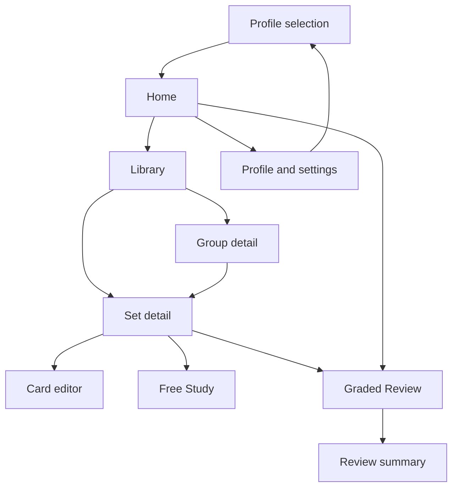

# Application Description & Screen Behavior

Version 1.1 — product-facing description. See Functional Requirements for scope and Business Rules for policy.

## 1. Navigation structure

Primary navigation: Home, Library, Profile/Settings. P2 progress may live on Home or Profile, without a separate tab. Editor and study destinations use a normal back stack; active profile changes reset it. Top-level navigation is hidden during focused study.

## 2. Screen inventory and behavior

| ID | Screen | Main content and actions | Requirements |
| --- | --- | --- | --- |
| UI-01 | Profile selection / onboarding | Existing profiles, active marker, add profile; create dialog with name; choose profile; empty first-run prompt. | FR-01, FR-02 |
| UI-02 | Home | Active profile, counts of new/due reviewed cards, Review now, library shortcut, optional coverage. | FR-10, FR-13 |
| UI-03 | Library | Groups, Ungrouped sets, set/card counts, add group/set, edit and delete menus. | FR-03, FR-04 |
| UI-04 | Group detail | Group name and description, owned sets, add/move/edit/delete group. | FR-03, FR-04 |
| UI-05 | Group/set editor | Name, optional description, optional group for set, save/cancel, field errors. | FR-03, FR-04 |
| UI-06 | Set detail | Name, description, total and eligible cards, list of card previews, Add card, Free Study, Grade Mode; edit/move/delete actions. | FR-04, FR-05, FR-07, FR-08, FR-10 |
| UI-07 | Card editor | Front text, back text, optional side-specific image selectors if P2, save/cancel, delete for existing card. | FR-05, FR-06 |
| UI-08 | Free Study | Front/back card, position, flip, Previous/Next, exit; no grading controls or learning score. | FR-07 |
| UI-09 | Graded Review | Current card, progress, flip, Remembered/Forgot enabled after reveal; saving indicator. Both ratings, Exit and system Back are disabled during save. Navigation resumes after success or failure. | FR-08, FR-09, FR-12 |
| UI-10 | Review summary | Reviewed, remembered, forgot, recall rate if defined; Done / return to start scope. | FR-11 |
| UI-11 | Profile/settings | Active profile, rename/delete/switch, optional appearance preferences. | FR-01, FR-02, FR-15 |

## 3. Screen states and interaction contract

### Library and content editing

- Show loading only while data is genuinely pending; an empty library includes a create action instead of a blank screen.
- Save is enabled only for valid fields; display clear validation and preserve input if saving fails.
- Warn before leaving changed unsaved forms; save returns to the parent screen.
- Destructive dialogs name the target and explain consequences. Deleting a group explicitly states sets will be moved to Ungrouped.
- Use overflow menus for edit/delete to keep primary study controls conspicuous.

### Study

- Card front text is readable without scrolling the full screen; long content can scroll inside the card; optional images fit without cropping essential content.
- Show visible “Front” / “Back” or equivalent labels; flip has a labeled accessible action. Animation supports comprehension but is not needed to study.
- Free Study shows current position and navigation; no grade indicators.
- Graded Review shows position and number of cards reviewed; the user first attempts recall, then reveals the answer. Buttons use both text and icon. No ambiguous unlabeled red or green buttons.
- Save failure leaves the card visible with retry. If no eligible cards exist, stay on Home or Set Detail, explain that nothing is due and offer Library or Free Study.

### Profile, offline and lifecycle

- Active profile is visible on Home/Library; no cross-profile content is retained in screen state after switch.
- Returning from background refreshes due counts if the date has changed.
- No cloud connectivity error screen exists because basic features are local. Local database/file failures show actionable feedback.
- Rotation preserves necessary input and current study state. Process restart restores profile and committed data; exact unfinished session resumption is not required.

## 4. Adaptive layout

- Compact width: one column, top bar, bottom navigation for primary destinations.
- Medium/expanded: use additional width for cards and lists; optionally a navigation rail and list/detail panes (P2).
- Support landscape and font scaling without truncating primary grading actions. Allow vertical scrolling on constrained screens.

## 5. Traceability

All MVP screens and activities map to FR-01–FR-12 (except optional FR-06). UI-02 and UI-11 have optional extensions only. Do not add an authentication screen, cloud-sync settings, public feed, or timer by default.
