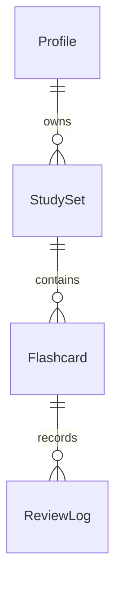

# Data model — Set-scoped study

**Baseline**: v3.0. Room owns profiles, sets, cards and review history. Preferences DataStore
stores the active profile ID. The [feature specification](spec.md) defines observable behavior.

## Room schema v1

Use generated, non-reused Long IDs for profiles, sets and cards. IDs and creation timestamps
are immutable. Store instants as Unix epoch milliseconds and due dates as local calendar
epoch days. Convert dates to and from Kotlin-facing `LocalDate`. All fields are required
unless marked nullable.

| Table | Fields | Keys and indexes |
| --- | --- | --- |
| Profile | id, displayName, createdAt | Primary key id. |
| StudySet | id, ownerId, name, nullable description | Primary key id. ownerId references Profile.id with delete cascade. Index ownerId. |
| Flashcard | id, setId, front, back, createdAt, stage (default 0), nullable dueDay (default null) | Primary key id. setId references StudySet.id with delete cascade. Index (setId, createdAt, id) and (setId, dueDay, id). |
| ReviewLog | sessionId (UUID text), cardId, grade (Remembered or Forgot), reviewedAt | Primary key (sessionId, cardId). cardId references Flashcard.id with delete cascade. Index cardId. |

Cards inherit owner through their set. Logs inherit owner and set through their card.
StudySet has only the four fields above. A study session is in-memory state with a UUID and
originating profile and set IDs. Its committed ratings persist in ReviewLog.

### Validation and mutations

- Trim `Profile.displayName` and require a nonblank value. A rename keeps `Profile.id`
  and `Profile.createdAt`. Trim `StudySet.name` and require 1–80 characters. Trim
  `StudySet.description`, store a blank value as null, and accept up to 500 characters
  after trimming.
- Trim `Flashcard.front` and `Flashcard.back` and require 1–2,000 characters per face.
  Duplicate names and card text are allowed. Validate in the editor and at the repository
  boundary. Invalid input leaves the stored record intact.
- Set metadata edits update name and description only. Card text edits update its faces only.
  Grading updates `Flashcard.stage` (0–6) and `Flashcard.dueDay`. The transaction records
  a valid `ReviewLog.grade` and `ReviewLog.reviewedAt`.
- Confirm profile, set and card deletions before writing. Room cascades through owned
  descendants and preserves unrelated records. Verify parent ownership and check affected
  rows for scoped mutations.

### Pre-release reset

The app is unreleased with no real user data. Replace the development schema and exported
v1 JSON with this four-table v1 baseline. Use a clean development database for verification.
The reset requires no migration from the Phase 2 development schema. Validate any saved
profile ID against the current database before use. Schema changes affecting released user
data require a data-preserving migration.

## Repositories and ownership

One AppContainer constructs repositories with direct DAO injection. Use Flow for observations
and suspend functions for one-time reads and writes. Scope every owned operation to its
captured `profileId`, verify parent relationships in DAO queries, and guard stale routes
before displaying data. A profile switch clears old UI state and cancels observations. A
started operation may finish only for its originating profile.

| DAO and repository | Responsibility |
| --- | --- |
| ProfileDao / ProfileRepository | Profile metadata, CRUD, validated selection and Preferences DataStore. |
| LibraryDao / LibraryRepository | Owned set and card CRUD, Set List and Set Detail projections, total and eligible counts per set, and card rows with saved dates. Use the requested set and owner for detail and card mutations. |
| ReviewDao / ReviewRepository | One-set eligibility, queue snapshots, current-card lookup, grade submission and committed session counts. Require `profileId: Long` and `setId: Long` for each study operation. |

A valid saved profile opens Set List. Otherwise show creation if no profiles remain or the
selector requiring explicit choice, including with one survivor. Offer retry on read failure.
If creation succeeds and selection fails, retry the existing ID. Delete the profile in Room
before clearing its preference and clear it only if that ID is still selected.

## Set-scoped study queries

The repository and DAO require `setId: Long` on all study calls, with no nullable or default
scope. The table shows scope arguments. Repository-facing date inputs use `LocalDate`; the
DAO uses an epoch day. Other grade inputs include the rating and the actual grade instant.

| Operation | Required scope | Verification |
| --- | --- | --- |
| `observeReviewCounts` and `getEligibleCardIds` | profileId, setId, local day | Use the same eligibility predicate as the library's counts. Read only the target set under its owner. |
| `getEligibleCard` and its DAO lookup | profileId, setId, cardId, with local day for eligibility | Match the parent set and owner, and skip a deleted or ineligible card. |
| `submitGrade` and DAO `hasGrade`, `insertGrade` and `updateSchedule` | profileId and setId, plus sessionId, cardId, grade/date inputs as applicable | Verify the card belongs to the originating set and owner before checking the existing grade, inserting a log or updating its schedule. |
| `getSessionCounts(profileId: Long, setId: Long, sessionId: String)` on both layers | profileId, setId, sessionId | Join logs through cards and sets, filtering by all three values. An unrelated set, profile or session contributes no counts. |

Set List may aggregate separate counts across the selected profile's set rows. Each row's
counts apply only to that set and include zero for an empty set. Set Detail uses that same
predicate for its set. Refresh both views when the local day changes on foreground return and
recheck the selected set on Start study.

## Queue and grade transaction

1. Snapshot eligible card IDs for the selected set at start. A null dueDay means new. A
   reviewed card is eligible when dueDay is on or before the local day. Order reviewed cards
   by dueDay then ID, followed by new cards by createdAt then ID. Leave an empty start on
   Set Detail. Recheck availability when presenting each card. Preserve original queue
   positions when skipping. Later arrivals wait for another session.
2. Keep the UUID, profile ID, set ID, frozen IDs, index, face and reveal state in the study
   ViewModel across rotation. Start each card on Front. After the first reveal this card can
   be rated even if flipped back. A profile switch discards the session.
3. On a rating tap, enter saving state and disable both ratings, Exit and system Back.
   In one DAO transaction check membership in the originating profile and set. If a
   (sessionId, cardId) log already exists, preserve that log and schedule. For a new grade,
   recheck eligibility, compute the next date from the actual local review day, insert the
   log and update exactly one card. Failures or a zero-row update roll back both writes.
4. Restore navigation when the write completes. Advance once after commit. On failure retain
   the revealed card for retry. Read committed totals with `getSessionCounts` using the
   original scope. Early exit leaves committed data in place. On process restart, a fresh
   queue uses current eligibility.

## Verification

| Exercise | Expected result | Trace |
| --- | --- | --- |
| Select two profiles and try stale IDs and an in-flight write during switch. | A's write remains in A and B sees or updates no A records. | FR-01, FR-02, BR-01, BR-02 |
| Edit text and delete a card, set or profile in separate fixtures, then reopen. | Edits preserve schedules and history. Deletion affects only the selected descendants. | FR-04, FR-05, BR-03, BR-05–BR-07 |
| Seed multiple sets, two profiles, date ties, future cards and a forgotten card. | Counts and queues reflect only the target set. Study lookups, grades and summary counts exclude foreign sets and profiles. | FR-08–FR-11, BR-10–BR-13 |
| Fail after the log insert, retry, submit competing ratings and reopen. | Both writes roll back on failure. A successful rating stays unique and changes eligibility. | FR-09, FR-12, NFR-02, NFR-08 |
